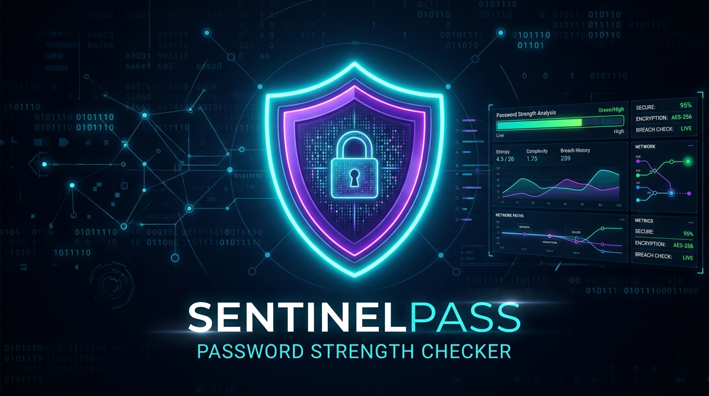

# 🛡️ SentinelPass — Advanced Password Strength Analyzer

<p align="center">
  
</p>

<p align="center">
  <strong>AVIP 2026 · CyberSecurity · Task 2 (Password Strength Checker)</strong>
</p>

<p align="center">
  
  
  
  
</p>

---

## 📖 Overview

**SentinelPass** is a privacy-first, zero-dependency cybersecurity tool engineered to evaluate password hygiene, detect predictable patterns, and generate transparent security recommendations. 

Instead of opaque estimates or arbitrary rules, SentinelPass combines:
- **Entropy Quantification** (mathematical bit assessment)
- **Heuristic Quality Scoring** (length thresholds & character composition)
- **Pattern & Vulnerability Heuristics** (keyboard sequences, repeating runs, and common password dictionaries)

> 🔒 **Zero-Knowledge Architecture:**  
> Password input is masked at the terminal layer with `getpass` (no keystroke echoes). Plaintext passwords are never saved, cached, transmitted, or logged. Generated JSON audit reports contain only assessment telemetry.

---

## 🚀 Key Highlights

<p align="center">
  
</p>

- 🕶️ **Hidden Terminal Input**: Zero-echo password ingestion safeguarding against shoulder-surfing.
- ⚙️ **Configurable Security Policies**: Easily adjust length criteria, required character types, and score ranges via JSON policy files.
- 🧮 **Granular Heuristic Breakdown**: Detailed rule-by-rule pass/fail indicators (`--show-checks`).
- 📊 **Structured JSON Export**: Generate machine-readable audit reports for integration with CI/CD or security pipelines.
- 🧪 **Pure Python Standard Library**: 0 external runtime dependencies; lean, auditable, and lightning-fast.

---

## 📋 Evaluation Metrics

| Metric | Details |
| :--- | :--- |
| **Length Checks** | Configured minimum (e.g. 12) & recommended (16+) lengths |
| **Character Diversity** | Upper-case (`A-Z`), Lower-case (`a-z`), Digits (`0-9`), Special Symbols |
| **Sequence Detection** | Alphabetic, numeric, and QWERTY keyboard-row pattern identification |
| **Repeated Runs** | Penalty applied to redundant character loops (`aaaa`, `1111`) |
| **Breach/Common Wordlist** | Built-in check for standard top predictable passwords |
| **Entropy Estimation** | Shannon-style character-space bit calculation |

---

## ⚡ Quick Start

### 1. Run Directly (No setup required)

```powershell
python -m src.sentinelpass.cli
```

### 2. View Individual Rule Pass/Fail Checks

```powershell
python -m src.sentinelpass.cli --show-checks
```

### 3. Generate a JSON Audit Report

```powershell
python -m src.sentinelpass.cli --json examples/my_report.json
```

---

## 💻 Sample Terminal Output

```text
SENTINELPASS | SECURITY ASSESSMENT
──────────────────────────────────────
Category             : Moderate
Heuristic score      : 53/100
Length               : 9 characters
Entropy estimate     : 53.6 bits (assumptions apply)

Findings
  • Below the configured minimum of 12 characters.
  • Missing symbols.
  • Contains an obvious sequence or keyboard-row pattern.

Rule checks
  FAIL  minimum_length
  FAIL  recommended_length
  PASS  lowercase
  PASS  uppercase
  PASS  digit
  FAIL  symbol
  PASS  not_common
  FAIL  no_obvious_sequence
  PASS  no_long_repeated_run

Recommendations
  • Use at least 16 characters; a long unique passphrase can help.
  • Avoid keyboard rows, alphabet runs, and number sequences.
```

---

## 🛠️ Configuration & Policy

You can tailor the assessment policy in [`src/sentinelpass/policy.json`](src/sentinelpass/policy.json):

```json
{
  "minimum_length": 12,
  "recommended_length": 16,
  "require_uppercase": true,
  "require_lowercase": true,
  "require_digit": true,
  "require_symbol": true,
  "max_repeated_run": 3,
  "score_thresholds": {
    "moderate": 45,
    "strong": 75
  }
}
```

Or pass a custom policy at runtime:

```powershell
python -m src.sentinelpass.cli --policy path/to/custom_policy.json
```

---

## 🧪 Automated Testing

Execute the test suite with Python's built-in `unittest` runner:

```powershell
$env:PYTHONPATH="src"; python -m unittest discover -s tests -v
```

All 8 tests run and validate length checks, common flags, policy updates, and zero-leak report integrity.

---

## 📁 Project Structure

```text
CS_1_PasswordStrengthChecker_BYTE/
├── screenshots/             # Visual banners & architecture illustrations
│   ├── sentinelpass_hero_banner.jpg
│   └── sentinelpass_architecture.jpg
├── src/
│   └── sentinelpass/
│       ├── __init__.py
│       ├── analyzer.py      # Core heuristic scoring and entropy logic
│       ├── cli.py           # Command-line interface and formatting
│       └── policy.json      # Configurable evaluation parameters
├── tests/
│   ├── __init__.py
│   └── test_analyzer.py     # Automated unit test suite
├── examples/
│   ├── sample_report.json   # Synthetic demonstration reports
│   └── my_report.json
├── pyproject.toml
└── README.md
```

---

## ⚖️ Security Disclaimer

SentinelPass provides educational heuristic assessments based on structural metrics and common pattern recognition. It does not replace full dictionary or breached-password hash verification (such as HaveIBeenPwned API) and should be used alongside robust multi-factor authentication (MFA) practices.

---

<p align="center">
  Crafted for <strong>AVIP 2026 · CyberSecurity Task 2</strong>
</p>
